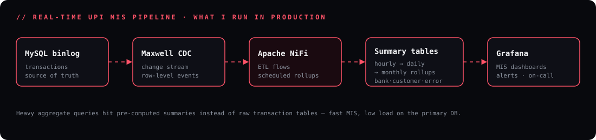
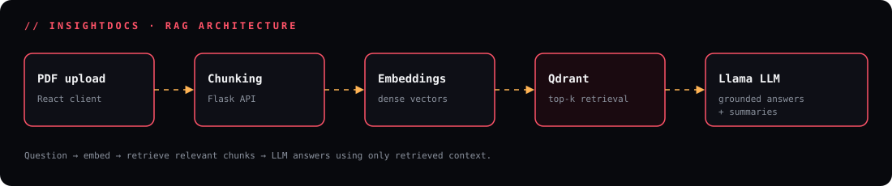

<div align="center">




<a href="https://github.com/ShikharGupta0813"></a>
<a href="https://www.linkedin.com/in/shikhargupta0813/"></a>
<a href="https://leetcode.com/u/Shikhar0813"></a>
<a href="https://github.com/ShikharGupta0813?tab=repositories"></a>


</div>

---

## `01 / WHOAMI`

<table>
<tr>
<td width="55%" valign="top">

```yaml
name:      Shikhar Gupta
role:      Software Development Engineer (SDE-1)
company:   OneStack · FinTech
base:      India 🇮🇳
education: B.Tech CSE · IIIT Sonepat
jee:       97 percentile
focus:     [backend, data-pipelines, observability, applied-ai]
mode:      build deliberately · debug relentlessly
```

I build the parts of fintech that **must not break** — UPI transaction systems, credit-bureau integrations, authentication, and the data pipelines that turn millions of rows into real-time MIS.

Started at OneStack as an intern, got retained full-time as **SDE-1**. Off the clock I'm shipping RAG systems, grinding DSA, and pushing toward **system design and backend architecture**.

</td>
<td width="45%" valign="top" align="center">



</td>
</tr>
</table>

## `02 / EXPERIENCE`

<details open>
<summary><b>⚡ OneStack — SDE-1 · FinTech</b> &nbsp;<sub>Jul 2026 – Present · (Intern Jan 2026 – Jun 2026)</sub></summary>
<br/>

- Engineer on production fintech backends handling **10K+ daily transactions**.
- **UPI / NPCI systems** — work on the PHP (CodeIgniter 3) UPI services and cron jobs: shared controller/library logic, structured application logging, and **correlation IDs** to trace a single transaction end-to-end.
- **Credit bureau integration** — integrated **Equifax** bureau functionality into the production backend.
- **Authentication** — built password, **OTP**, and **Google SSO** login flows (Ion Auth), unified behind one shared login-completion path.
- **Data engineering** — own an **Apache NiFi** ETL pipeline: Maxwell CDC on MySQL binlogs → hourly summary tables → daily and monthly rollups by bank, customer, and error code; building automated month-end rollup flows.
- **Observability** — backend metrics, **Grafana** dashboards, and alerts used for monitoring and production debugging.

<div align="center">

</div>

</details>

<details>
<summary><b>Mocapay Infotech — Full Stack Intern</b></summary>
<br/>

- Built and deployed MERN-based web applications.
- Integrated AI APIs to automate application workflows.

</details>

<details>
<summary><b>Fleek IT Solutions — SDE Intern</b></summary>
<br/>

- Developed REST APIs and backend services.
- Worked on an ML-based defect-risk prediction project and CI/CD-enabled workflows.

</details>

## `03 / SELECTED BUILDS`

<table>
<tr>
<td width="50%" valign="top">

### 🧠 [InSightDocs](https://github.com/ShikharGupta0813/InSightDocs)

**AI-powered PDF summarization and Q&A**

Cloud document-analysis platform: upload PDFs, get summaries, and ask questions answered from retrieved context by a Llama model.

`Python` `Flask` `React` `Llama` `Qdrant` `RAG`

[Source code](https://github.com/ShikharGupta0813/InSightDocs) · [Live demo](https://novafrost.strangled.net)

</td>
<td width="50%" valign="top">

### 🔍 [Rag-System](https://github.com/ShikharGupta0813/Rag-System)

**Retrieval-Augmented Generation**

Experiments with RAG pipelines — chunking strategies, embeddings, and retrieval quality.

`RAG` `Embeddings` `Vector Search`

[View repository](https://github.com/ShikharGupta0813/Rag-System)

</td>
</tr>
<tr>
<td width="50%" valign="top">

### 🔐 [CipherBox](https://github.com/ShikharGupta0813/CipherBox)

**Encrypted document sharing and secure chat**

Secure collaboration app with encrypted chat and document sharing.

`JavaScript` `Encryption` `Web App`

[View repository](https://github.com/ShikharGupta0813/CipherBox)

</td>
<td width="50%" valign="top">

### 📡 [TraceLink](https://github.com/ShikharGupta0813/TraceLink)

**Android + Flask data analysis**

Android app with a Flask backend for collecting and analyzing device data.

`Kotlin` `Flask` `REST APIs`

[View repository](https://github.com/ShikharGupta0813/TraceLink)

</td>
</tr>
<tr>
<td width="50%" valign="top">

### ✍️ [MindVista](https://github.com/Akshat161/MindVista)

**Blogging website**

Full-stack blogging platform built collaboratively.

`JavaScript` `Web Development`

[View repository](https://github.com/Akshat161/MindVista)

</td>
<td width="50%" valign="top">

### ⚔️ [DSA-SOLUTIONS](https://github.com/ShikharGupta0813/DSA-SOLUTIONS)

**Problem-solving archive**

LeetCode solutions across core patterns — prepared through Striver's A2Z sheet.

`C++` `DSA` `LeetCode`

[View repository](https://github.com/ShikharGupta0813/DSA-SOLUTIONS) · [LeetCode profile](https://leetcode.com/u/Shikhar0813)

</td>
</tr>
</table>

<div align="center">



</div>

## `04 / TECH ARSENAL`

<div align="center">


</div>

| Domain | Technologies |
| --- | --- |
| **Languages** | C++, C, Python, Java, JavaScript, PHP |
| **Backend** | Node.js, Express.js, Flask, CodeIgniter 3, REST APIs |
| **Payments / FinTech** | UPI (NPCI) integrations, credit-bureau (Equifax) integration, OTP & SSO auth |
| **Frontend** | React |
| **Data** | MySQL, PostgreSQL, MongoDB, Apache NiFi, Maxwell CDC, Qdrant |
| **Infrastructure** | Docker, AWS EC2, Nginx, Linux, CI/CD |
| **AI / ML** | RAG, LLMs (Llama, Mistral-7B), Hugging Face Transformers, PyTorch, TensorFlow, embeddings, NLP |
| **Observability** | Grafana dashboards & alerts, structured logging, correlation IDs |

## `05 / GITHUB TELEMETRY`

<div align="center">


<br/>


<br/>


<br/><br/>

<!-- Generated by .github/workflows/snake.yml -->
<picture>
  <source media="(prefers-color-scheme: dark)" srcset="https://raw.githubusercontent.com/ShikharGupta0813/ShikharGupta0813/output/github-snake-dark.svg"/>
  <source media="(prefers-color-scheme: light)" srcset="https://raw.githubusercontent.com/ShikharGupta0813/ShikharGupta0813/output/github-snake.svg"/>
  
</picture>

</div>

## `06 / CURRENT FOCUS`

```bash
$ focus --now
> System design & backend architecture
> Database performance · CDC · ETL at scale
> Production engineering: monitoring, debugging, reliability
> Applied AI: RAG, agentic systems, LLM security
> DSA — daily reps
$ next --level
> Java / Spring Boot · Go
```

---

<div align="center">


<sub>LESS NOISE. BETTER SYSTEMS. CONSISTENT EXECUTION.</sub>

</div>
